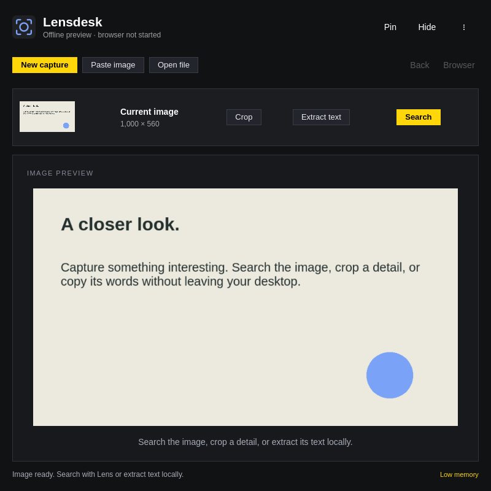

# Lensdesk — native panel preview



An optional C++/Qt Quick panel with an embedded Qt WebEngine view. It lives
alongside the working `google-lens` launcher. Native Google upload, CAPTCHA,
desktop capture, and repeat-search compatibility still require a live desktop
test; the old launcher remains the default.

## Features

- One persistent window, with New capture, Paste image, Open file, Back, Search
  again, Pin, Hide, and Open in browser controls.
- Local PNG/JPEG/WebP input and drag-and-drop; opening an image does not upload it.
- New capture automatically searches the selection. `--text` captures for local
  OCR only. The application hides itself while selecting the screen region.
- Crop the current image and undo the last crop without changing the original file.
- Local Tesseract text extraction with a selectable result and Copy to clipboard.
- Omarchy accent and corner style, live language changes, and stored window size.
- A persistent isolated web profile and a mode that unloads the embedded browser
  after the panel has been hidden for five minutes.
- Background image decode/encode and a small local binary image handoff, replacing
  the Python/Node coordination and remote debugging used by the stable launcher.

Embedding Chromium does not guarantee lower memory consumption. Performance must
be compared on a live desktop before promoting this version. Qt uses its own
profile under `~/.local/share/lensdesk`; the existing Chromium profile is neither
copied nor modified. You may need to complete Google's verification again.

Only the current image and one crop undo are retained in memory. Temporary OCR and
capture files are removed when the application exits. No screenshot history is
saved. Closing the window hides it; Ctrl+Q or the menu's Quit action exits fully.
Run `lensdesk` again to bring back a hidden window.

## Build and run

Requirements: qmake6, make, GCC, Qt 6 Base/Declarative/WebEngine/Wayland/SVG,
xdg-desktop-portal, and Omarchy's screenshot tools. Tesseract and an installed
language pack are needed only for text extraction.

```sh
./bin/build
./build/lensdesk                 # Open the panel
./build/lensdesk --capture       # Select and search a region
./build/lensdesk --text          # Select and extract text locally
./build/lensdesk /path/image.png # Open a file without uploading it
./build/lensdesk --check --json  # Check dependencies without a display
./bin/test
```

Use `./bin/install-user` to install the preview next to the existing launcher.
For an Arch package, run `makepkg` from `pkgbuild/`; `./bin/install` builds and
installs that package. No keybindings or default browser associations are changed.

## Offline UI verification

```sh
QT_QPA_PLATFORM=offscreen QT_QPA_PLATFORMTHEME=generic \
QT_QUICK_BACKEND=software ./build/lensdesk \
  --preview --language en --screenshot /tmp/lensdesk-preview.png
```

This renders the real QML with made-up sample content and no browser engine,
network requests, or uploads. Repeat with `--language da` to check longer labels.
It does not prove Google compatibility. `bin/test` exercises file loading,
cropping/undo, preferences, URL validation, and actual QML button/dialog interaction.

## Keyboard shortcuts

| Shortcut | Action |
| --- | --- |
| Ctrl+N | Capture and search |
| Ctrl+O | Open an image through the desktop portal |
| Ctrl+Shift+V | Paste an image |
| Ctrl+Q | Quit |
| Ctrl+Z | Undo crop before a search is open |
| Space | Capture before a search is open |
| ? | Help before a search is open |
| Q | Quit before a search is open |

Single-letter shortcuts are disabled while results are open so they do not
interfere with typing into Google. The menu always exposes help and Quit.

## Live acceptance checks before changing the default

1. Search two captures and confirm that only one native window exists.
2. Complete any Google verification and repeat a search in the same session.
3. Cancel capture and verify that the old image/results return.
4. Try file chooser, clipboard, file drop, recrop, and local OCR.
5. Hide for five minutes, reopen, and confirm the browser reloads with its profile.
6. Compare cold/repeated search time and process memory against `google-lens`.
7. Check monitor changes, restored geometry, pinning, and live theme/language changes.

The theme and translation helpers are adapted from the Omarchy app templates
(MIT, David Heinemeier Hansson); see LICENSE.
